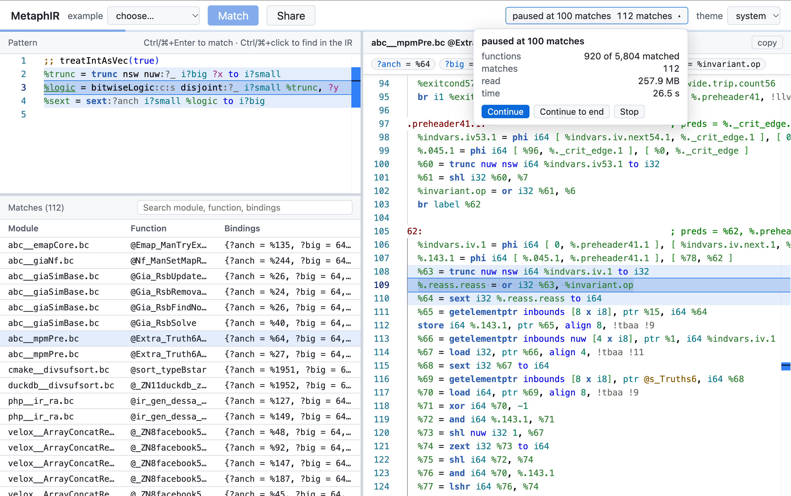

# MetaphIR

A domain-specific language (DSL) for matching LLVM IR patterns,
built to describe the preconditions of InstCombine folds.
See the [Wiki](https://github.com/xuhongxu96/metaphir/wiki) for the language.

```llvm
; (X u/ 2) + (X u% 2), in either order
%div = udiv i?n ?x, 2
%rem = urem i?n ?x, 2
%sum = add:c i?n %div, %rem
;; ugt(?n, 1) && isKnownNonZero(?x)
```



## Building

MetaphIR builds against a pinned, patched LLVM checkout in `llvm-project/`:

```sh
scripts/prepare_llvm.sh release        # or: debug
cmake -G Ninja -S . -B build -DCMAKE_BUILD_TYPE=Debug
cmake --build build
ctest --test-dir build -j
```

### `scripts/prepare_llvm.sh`

Fetches the pinned LLVM commit, applies `eval/patches/` (needed only for the
evaluation), builds and installs LLVM into `llvm-project/build-<type>`, and
links `llvm-project/build` to it.

```
scripts/prepare_llvm.sh [debug|release] [--force] [--source-only]
```

| Argument | |
|---|---|
| `debug` \| `release` | build type (default: `$LLVM_BUILD_TYPE`, else `release`) |
| `--force` | discard changes in `llvm-project` that are not saved in `eval/patches/` |
| `--source-only` | stop once the source is patched (e.g. for `scripts/build_wasm.sh` alone) |

| Environment variable | Default | |
|---|---|---|
| `LLVM_BUILD_TYPE` | `Release` | build type when none is given |
| `LLVM_BUILD_DIR` | `llvm-project/build-<type>` | build directory |
| `CACHE_DIR` | ccache's default | ccache directory |
| `JOBS` | `nproc` | parallel build jobs |

> [!NOTE]
> The script resets `llvm-project` before applying the patches, so it stops
> if the checkout has changes not saved in `eval/patches/`; pass `--force` to
> discard them.

### CMake options

| Option | Default | |
|---|---|---|
| `LLVM_DIR` | `llvm-project/build/install/lib/cmake/llvm` | LLVM to build against |
| `METAPHIR_LLVM_UTILS_DIR` | `llvm-project/build/bin` | where `llvm-lit`, `FileCheck` and `not` are |
| `METAPHIR_USE_SANITIZER` | (none) | sanitizer to build MetaphIR with, e.g. `address` |


## Getting started

This walkthrough runs every tool on a two-file corpus. It takes a minute once
`build/` is built (see [Building](#building)).

### 1. Set up

From the repository root, put the tools on `PATH` and make a scratch
directory, `/tmp/metaphir-try`, for the files below:

```sh
export PATH="$PWD/build/tools:$PATH"
mkdir -p /tmp/metaphir-try/corpus && cd /tmp/metaphir-try
```

Save this pattern, `(x << 1) + 1`, as `pattern.mpir`. Lines starting with
`;;` are constraints:

```llvm
; pattern.mpir: (x << 1) + 1
%twice = shl i32 ?x, 1
%sum = add i32 %twice, ?c
;; ?c == 1
```

Save this module as `corpus/a.ll`. `@odd` matches, and `@plus2` adds 2
instead of 1:

```llvm
; corpus/a.ll
define i32 @odd(i32 %x) {
  %t = shl i32 %x, 1
  %s = add i32 %t, 1
  ret i32 %s
}

define i32 @plus2(i32 %x) {
  %t = shl i32 %x, 1
  %s = add i32 %t, 2
  ret i32 %s
}
```

Save this module as `corpus/b.ll`. `@triple` has no `shl` at all:

```llvm
; corpus/b.ll
define i32 @triple(i32 %x) {
  %m = mul i32 %x, 3
  ret i32 %m
}
```

### 2. Read the pattern

`metaphir-lex` shows how the pattern is tokenized:

```
$ metaphir-lex --line-numbers pattern.mpir
2: LocalVar twice
2: equal
2: kw_shl
2: Type i32
2: MetaVar x
2: comma
2: APSInt 1
...
4: ConstraintMarker
4: MetaVar c
4: equalequal
4: APSInt 1
5: Eof
```

`metaphir-parse` shows how it is parsed, including its variables' kinds:

```
$ metaphir-parse pattern.mpir
pattern instructions=2 constraints=1
%twice = shl i32 ?x, 1
%sum = add i32 %twice, ?c
constraint (== ?c 1)
meta ?x type=Value
meta ?c type=Value
```

### 3. Match a file

By default, `metaphir-match` reports every function, and why a function whose
instructions matched still failed:

```
$ metaphir-match pattern.mpir corpus/a.ll
target 0: @odd
  match 0:
    {?c = 1, ?x = %x}
target 1: @plus2
  no match
  constraint not satisfied: (== ?c 1)
```

### 4. Match a directory

`--matches-only` prints one line per match (file, function, bindings), which
is what you want for many files. A directory is searched for `.ll` and `.bc`
files:

```
$ metaphir-match --matches-only pattern.mpir corpus
corpus/a.ll	@odd	{?c = 1, ?x = %x}
```

`--print-instructions` adds which IR instruction each pattern instruction
matched (`%twice` on pattern line 2 matched the function's instruction `#0`):

```
$ metaphir-match --matches-only --print-instructions pattern.mpir corpus
corpus/a.ll	@odd	{?c = 1, ?x = %x}	{%twice@2 = #0, %sum@3 = #1}
```

### 5. Index the corpus

An index records each function's features, so matching can skip the
functions that cannot match without reading them:

```
$ metaphir-index build corpus -o corpus.mpidx
indexed 2 files

$ metaphir-index dump corpus.mpidx
module a.ll: add shl ret; add-shl ret-add; 0 globals
  0: add shl ret; add-shl ret-add; 0 globals
  1: add shl ret; add-shl ret-add; 0 globals
module b.ll: mul ret; ret-mul; 0 globals
  0: mul ret; ret-mul; 0 globals
```

`stats` tells how much of the corpus the pattern may match. Only `@odd` is
left: `@triple` has no `shl`, and the index records that the constant `@plus2`
adds is `2`, so `;; ?c == 1` rules it out:

```
$ metaphir-index stats pattern.mpir corpus.mpidx
modules: 1 of 2 (50.00%)
bytes: 183 of 262 (69.85%)
functions: 1 of 3 (33.33%)
```

Match with the index; `--summary` reports how many functions were checked:

```
$ metaphir-match --matches-only --summary --index corpus.mpidx pattern.mpir corpus
matched 1 of 3 functions (in 1 of 2 files)
corpus/a.ll	@odd	{?c = 1, ?x = %x}
```

### 6. Publish for the website

`publish` writes the files the website matches over HTTP. `--packs` matches
them locally as the website does, without the corpus:

```
$ metaphir-index publish corpus.mpidx -o published
...
published 2 files (3 functions) to published

$ metaphir-match --matches-only --packs published pattern.mpir
a.ll	@odd	{?c = 1, ?x = %x}
```

Next: the [Wiki](https://github.com/xuhongxu96/metaphir/wiki) for the
language, and [Tools](#tools) for every option.

## Tools

| Command | |
|---|---|
| `metaphir-match <pattern> <.ll/.bc file or directory>...` | matches a pattern against every function |
| `metaphir-index build <directory> -o <index>` | indexes a corpus for `metaphir-match --index` |
| `metaphir-index dump <index>` | prints the features in an index |
| `metaphir-index stats <pattern> <index>` | counts the modules and functions of an index a pattern may match |
| `metaphir-index publish <index> -o <directory>` | publishes an indexed corpus for the web |
| `metaphir-parse <pattern>` | parses and prints a pattern |
| `metaphir-lex [--line-numbers] <file>` | prints the tokens of a file |

### `metaphir-match`

```
metaphir-match [options] <pattern> <.ll/.bc file or directory>...
```

| Option | |
|---|---|
| `--matches-only` | print only the matches, one tab-separated line each (see [Output](#output)) |
| `-j <n>` | match `n` files at once (`0`: one per hardware thread); needs `--matches-only` |
| `--print-instructions` | add which IR instruction each pattern instruction matched (see [Matched instructions](#matched-instructions)); needs `--matches-only` |
| `--index=<file>` | skip the files and functions the index shows cannot match (see [Indexing a corpus](#indexing-a-corpus)); needs `--matches-only` |
| `--trust-index` | match only the indexed candidates; needs `--index` |
| `--packs=<directory>` | match a published corpus instead of files (see [Website](#website)); needs `--matches-only` |
| `--summary` | print to stderr how many functions and files were checked |

The examples below use this pattern, `pattern.mpir`:

```llvm
; pattern.mpir: (X u/ 2) + (X u% 2), in either order
%div = udiv i?n ?x, 2
%rem = urem i?n ?x, 2
%sum = add:c i?n %div, %rem
;; ugt(?n, 1)
```

#### Output

| Mode | Prints | For |
|---|---|---|
| default | every function, numbered as a `target`, with each of its matches or `no match`, and why constraints failed | debugging a pattern on a few files |
| `--matches-only` | one line per match: file, `@function`, bindings, separated by tabs; nothing for functions without a match | corpora, scripts, and `-j`, `--index`, `--packs` |

For `%r = add i32 ?x, ?c` with `;; ?c == 2`, over a module whose `@f` is
`add i32 %a, 2` and `@g` is `add i32 %a, 1`:

```
$ metaphir-match pattern.mpir a.ll
target 0: @f
  match 0:
    {?c = 2, ?x = %a}
target 1: @g
  no match
  constraint not satisfied: (== ?c 2)

$ metaphir-match --matches-only pattern.mpir a.ll
a.ll	@f	{?c = 2, ?x = %a}
```

`constraint not satisfied` is printed only when the instructions matched and
a constraint then failed. A function without the instructions prints only
`no match`.

#### Matched instructions

`--print-instructions` adds a last column that maps each pattern instruction
to the IR instruction it matched:

```
%div@2 = #0
│    │   └─ the IR instruction: its position among all the function's
│    │      instructions, from 0, across blocks, terminators included
│    └──── the line of the pattern instruction in the pattern file
└───────── the pattern instruction, by result name (opcode if unnamed)
```

For `pattern.mpir` above:

```llvm
; f.ll
define i32 @f(i32 %x) {
entry:
  %d = udiv i32 %x, 2          ; #0  ← %div@2
  %unrelated = mul i32 %x, 3   ; #1
  br label %next               ; #2
next:
  %r = urem i32 %x, 2          ; #3  ← %rem@3
  %s = add i32 %r, %d          ; #4  ← %sum@4
  ret i32 %s                   ; #5
}
```

```
$ metaphir-match --matches-only --print-instructions pattern.mpir f.ll
f.ll	@f	{?n = 32, ?x = %x}	{%div@2 = #0, %rem@3 = #3, %sum@4 = #4}
```

Positions identify instructions whether or not they are named, and are what
the website highlights.

Instructions expanded from a composite matcher are named
`<use>$<instruction in the composite>`, and have the line of the use, however
deeply the composites nest. `signum` (from the standard library) expands to
`%neg`, `%lhs`, `%rhs` and `%ret`; its `%ret` is the use itself:

```llvm
; composite.mpir
%s = signum i32 ?x
%n = neg i32 %s
```

```llvm
; signum.ll
define i32 @signum(i32 %x) {
  %neg = sub i32 0, %x        ; #0  ← %s$neg@2
  %lhs = ashr i32 %x, 31      ; #1  ← %s$lhs@2
  %rhs = lshr i32 %neg, 31    ; #2  ← %s$rhs@2
  %ret = or i32 %lhs, %rhs    ; #3  ← %s@2
  %n = sub i32 0, %ret        ; #4  ← %n@3
  ret i32 %n
}
```

```
$ metaphir-match --matches-only --print-instructions composite.mpir signum.ll
signum.ll	@signum	{?x = %x}	{%s@2 = #3, %s$lhs@2 = #1, %s$neg@2 = #0, %s$rhs@2 = #2, %n@3 = #4}
```

An or-self matcher (`:o`) that matched its operand alone shares that
operand's position. In `@plain`, which has no `add`, `%sum` is the `sub`:

```llvm
; self.mpir
%diff = sub i32 ?x, ?y
%sum = add:o i32 %diff, 1
ret i32 %sum
```

```llvm
; self.ll
define i32 @plain(i32 %x, i32 %y) {
  %d = sub i32 %x, %y          ; #0  ← %diff@2, %sum@3
  ret i32 %d                   ; #1  ← ret@4
}

define i32 @plus1(i32 %x, i32 %y) {
  %d = sub i32 %x, %y          ; #0  ← %diff@2
  %s = add i32 %d, 1           ; #1  ← %sum@3
  ret i32 %s                   ; #2  ← ret@4
}
```

```
$ metaphir-match --matches-only --print-instructions self.mpir self.ll
self.ll	@plain	{?x = %x, ?y = %y}	{%diff@2 = #0, %sum@3 = #0, ret@4 = #1}
self.ll	@plus1	{?x = %x, ?y = %y}	{%diff@2 = #0, %sum@3 = #1, ret@4 = #2}
```

### `metaphir-index`

| Subcommand | Option | |
|---|---|---|
| `build <directory>` | `-o <file>` | the index file to write |
| | `-j <n>` | index `n` files at once (`0`: one per hardware thread) |
| | `--no-value-facts` | skip value-tracking facts: a faster build that prunes less |
| `dump <index>` | | print each module's and function's features |
| `stats <pattern> <index>` | | count what the pattern may match |
| `publish <index>` | `-o <directory>` | the directory to write the published files to |
| | `-j <n>` | pack `n` modules at once (`0`: one per hardware thread) |

#### Indexing a corpus

A corpus of three files, where only `@f` and `@h` match `pattern.mpir`:

| File | Functions |
|---|---|
| `corpus/a.ll` | `@f` (`udiv`, `urem`, `add`), `@g` (`mul`) |
| `corpus/b.ll` | `@h` (`urem`, `udiv`, `add`, operands swapped) |
| `corpus/c.ll` | `@k` (`fadd`) |

```
$ metaphir-index build corpus -o corpus.mpidx
indexed 3 files

$ metaphir-index stats pattern.mpir corpus.mpidx
modules: 2 of 3 (66.67%)
bytes: 270 of 341 (79.18%)
functions: 2 of 4 (50.00%)

$ metaphir-index dump corpus.mpidx
module a.ll: add mul udiv urem ret; add-udiv add-urem ret-add ret-mul; 0 globals
  0: add udiv urem ret; add-udiv add-urem ret-add; 0 globals
  1: mul ret; ret-mul; 0 globals
module b.ll: add udiv urem ret; add-udiv add-urem ret-add; 0 globals
  0: add udiv urem ret; add-udiv add-urem ret-add; 0 globals
module c.ll: fadd ret; ret-fadd; 0 globals
  0: fadd ret; ret-fadd; 0 globals
```

`dump` lists, per module and then per function, the instruction kinds, the
operand edges (`add-udiv`: an `add` uses a `udiv`) and the number of globals.

Matching with the index checks only the candidates, and `--summary` shows how
many functions and files that is. It counts the functions checked, not the
functions matched:

```
$ metaphir-match --matches-only --summary pattern.mpir corpus
matched 4 of 4 functions (in 3 of 3 files)
corpus/a.ll	@f	{?n = 32, ?x = %x}
corpus/b.ll	@h	{?n = 32, ?x = %x}

$ metaphir-match --matches-only --summary --index corpus.mpidx pattern.mpir corpus
matched 2 of 4 functions (in 2 of 3 files)
corpus/a.ll	@f	{?n = 32, ?x = %x}
corpus/b.ll	@h	{?n = 32, ?x = %x}
```

`c.ll` is not read at all, and `@g` is not materialized.

Files added or changed since indexing are matched in full, with a warning.
`--trust-index` skips that check: it neither lists the input directories nor
looks at the files for changes, so it is faster but misses such files. With a
new `corpus/new.ll` that also matches:

```
$ metaphir-match --matches-only --summary --index corpus.mpidx pattern.mpir corpus
metaphir-match: warning: corpus/new.ll: not indexed; matching it in full
matched 3 of 5 functions (in 3 of 4 files)
...
corpus/new.ll	@n	{?n = 32, ?x = %x}

$ metaphir-match --matches-only --summary --index corpus.mpidx --trust-index pattern.mpir corpus
matched 2 of 3 functions (in 2 of 2 files)
corpus/a.ll	@f	{?n = 32, ?x = %x}
corpus/b.ll	@h	{?n = 32, ?x = %x}
```

For a large corpus:

```sh
metaphir-index build -j 32 corpus -o corpus.mpidx
metaphir-match --matches-only -j 32 --index corpus.mpidx pattern.mpir corpus
```

### `metaphir-parse`, `metaphir-lex`

`metaphir-parse` parses a pattern and prints it with its constraints and the
types of its variables:

```
$ metaphir-parse pattern.mpir
pattern instructions=3 constraints=1
%div = udiv i?n ?x, 2
%rem = urem i?n ?x, 2
%sum = add:c i?n %div, %rem
constraint (ugt ?n 1)
meta ?n type=Nat
meta ?x type=Value
```

`metaphir-lex` prints the tokens of a file; `--line-numbers` prefixes each
with its line:

```
$ metaphir-lex --line-numbers pattern.mpir
2: LocalVar div
2: equal
2: kw_udiv
2: MetaIntVar n
2: MetaVar x
2: comma
2: APSInt 2
...
```

## How matching is narrowed

Before matching a function, `metaphir-match` compares the pattern with the
function's **features**:

| Feature | Example (from `corpus/a.ll` above) |
|---|---|
| instruction signatures: kind, flags and types | `udiv i32`, `add i32` |
| operand edges | `add-udiv`: an `add` uses a `udiv` |
| shared values | `%x`, used by both the `udiv` and the `urem` |
| globals | the globals the function uses (none here) |
| value facts at each instruction kind's operands | the constant `2` at operand 1 of `udiv`; constant classes; use counts; value-tracking facts (when indexing) |

A pattern variant is matched only where the function can have a match. Each
condition below prunes a function of `corpus` (checked with
`metaphir-index stats`):

| Condition | Pattern | Pruned |
|---|---|---|
| its instructions must be there | `pattern.mpir` | `@g` (no `udiv`), `@k` |
| their types must agree on the type variables | `%r = urem i8 ?x, ?c` | every function: their `urem`s are `i32` |
| no constraint may be false on the facts | `%r = urem i?n ?x, ?c` with `;; ?c == 4` | every function: the only `urem` constant is `2` |

Constraints are checked with the same evaluator as on the IR
(`metaphir/Matching/ConstraintEvaluator.h`), in a domain where anything the
facts cannot tell is unknown, and an unknown constraint does not prune. Each
operator's IR, recording and index semantics sit together in
`metaphir/Matching/Operators/`.

With an index, matching takes two steps:

1. `metaphir-index build` stores every function's features once, with posting
   lists from each coarse feature (instruction kind, edge, sibling pair,
   global) to the functions that have it.
2. `metaphir-match --index` intersects the pattern's shortest posting lists
   (for `pattern.mpir`: `udiv`, `urem`, `add-udiv`, …) to find its candidate
   functions, and checks those alone.

Each file of the corpus is then handled by what the index says about it:

| File | Handling | Example |
|---|---|---|
| indexed, no candidates | not read | `c.ll` |
| indexed, with candidates | loaded lazily; only the candidate functions are materialized | `a.ll`: `@f`, not `@g` |
| changed since indexing, or not indexed | matched in full (with a warning), unless `--trust-index` is given | `new.ll` |

## Website

A static site that matches MetaphIR patterns against a published corpus in
the browser.

| Part | Where it runs |
|---|---|
| the site | GitHub Pages, deployed from a separate public repository |
| the corpus | a public Hugging Face bucket, read by byte ranges over HTTP, only where a query needs it |
| MetaphIR | WebAssembly, in the browser |

### The page

The page is React, in resizable panes:

| Pane | Shows |
|---|---|
| pattern | the pattern, in Monaco |
| matches | the matches, below the pattern; the arrow keys move through them |
| IR | the selected match's function, with its bindings listed and the instructions it matched highlighted (as `metaphir-match --print-instructions` reports them) |

- Hovering a matched instruction in either editor highlights its counterpart
  in the other.
- A progress bar follows each stage's reads, then the matching.
- The theme follows the system unless one is chosen.

**Share** copies a link that carries the pattern. Links of either kind open
in any browser:

| Link | Pattern encoding | When |
|---|---|---|
| `#patternz=` | its tokens as bytes, deflated, in base64url (as instcombine-instrumentor's links carry IR); see `web/src/share/` | by default |
| `#pattern=` | plain text | where the browser cannot compress |

### Building the site

```sh
scripts/prepare_llvm.sh --source-only   # or a full native build
scripts/build_wasm.sh                   # build-wasm/, then web/public/wasm/
cd web && npm ci && npm run build       # web/dist/
```

`scripts/build_wasm.sh` builds under `build-wasm/`, then copies the modules
into `web/public/wasm/`:

| Directory | Contents |
|---|---|
| `build-wasm/emsdk` | the Emscripten SDK, unless `EMSDK` is set |
| `build-wasm/host` | `llvm-tblgen`, when `llvm-project` has no native build |
| `build-wasm/llvm` | LLVM's libraries, built for WebAssembly from `llvm-project` |
| `build-wasm/metaphir` | `metaphir.{js,wasm}` and `metaphir-match.{js,wasm}` |

| Environment variable | Default | |
|---|---|---|
| `EMSDK` | `build-wasm/emsdk` | an activated Emscripten SDK to use instead |
| `CACHE_DIR` | ccache's default | ccache directory; compiles use ccache when it is installed |
| `JOBS` | `nproc` | parallel build jobs |

> [!IMPORTANT]
> Build the native tools and the site from the same `llvm-project`: a
> published corpus records the LLVM revision it was made with.

### Publishing a corpus

```sh
metaphir-index build -j 32 corpus -o corpus.mpidx
metaphir-index publish -j 32 corpus.mpidx -o published
web/scripts/publish.py published
```

`metaphir-index publish` writes, compressed with zstd and trained
dictionaries (see `metaphir/Web/WebIndex.h`):

- the posting keys and lists of the index,
- each function's features,
- a pack of each function alone, with stubs for the globals it uses and how
  its module uses its constants.

`web/scripts/publish.py` uploads them to `builds/<build>/` in the bucket,
uploading `manifest.json` last, and points `web/public/config.json` at the
build:

```
web/scripts/publish.py [--keep <n>] [--config <file> | --no-config] <published> [<owner>/<bucket>]
```

| Argument | Default | |
|---|---|---|
| `<published>` | | the directory `metaphir-index publish` wrote |
| `<owner>/<bucket>` | `xuhongxu96/llvm-opt-benchmark-index` | the bucket to upload to |
| `--keep <n>` | `3` | how many builds the bucket keeps, this one among them; older ones are removed |
| `--config <file>` | `web/public/config.json` | the site's config to point at the build |
| `--no-config` | | leave the site's config as it is |

> [!WARNING]
> A deployed site reads one build. Deploy it again before `--keep` newer
> builds are published, or its build is removed.

The same files can be matched from the command line, as the site does,
without the corpus. For the corpus from
[Indexing a corpus](#indexing-a-corpus):

```
$ metaphir-index publish corpus.mpidx -o published
...
published 3 files (4 functions) to published

$ ls published
features.bin  functions.idx  header.bin.zst  keys.bin  lists.bin  manifest.json  packs.bin

$ metaphir-match --matches-only --summary --packs published pattern.mpir
matched 2 of 4 functions (2 on the posting lists)
a.ll	@f	{?n = 32, ?x = %x}
b.ll	@h	{?n = 32, ?x = %x}
```

For a published build:

```sh
hf buckets sync hf://buckets/xuhongxu96/llvm-opt-benchmark-index/builds/<build> published
metaphir-match --matches-only --packs published pattern.mpir
```

### Deploying the site

This repository is private, so the site is deployed from a separate public
repository. That repository holds the built site and `web/site/`'s workflow,
which deploys it to GitHub Pages as it is.

```sh
web/scripts/deploy_site.sh ../metaphir-site --commit
git -C ../metaphir-site push
```

```
web/scripts/deploy_site.sh <site repository> [--data <url>] [--commit]
```

| Argument | |
|---|---|
| `<site repository>` | the public repository; created (`git init`) if missing, and everything in it but `.git` is replaced |
| `--data <url>` | the published corpus the site reads (default: `web/public/config.json`'s) |
| `--commit` | commit the site in the site repository; push it yourself |

Run `scripts/build_wasm.sh` first; the script builds the site itself.

### How a query runs

1. The page reads `manifest.json` and the header once: the module directory,
   a sparse table of the posting keys, and the dictionaries.
2. Each stage of `WebQuery` names the byte ranges the next one reads
   (`web/src/pipeline.ts`):

   | Stage | Reads |
   |---|---|
   | 1 | the blocks holding the pattern's posting keys |
   | 2 | the shortest posting lists |
   | 3 | the index entries and features of the functions on all of them |
   | 4 | the packs of the functions whose features may match |

3. Workers, each with its own WebAssembly instance, match the packs as they
   arrive (`web/src/pool.ts`).

#### Reading and caching

| | How | Why |
|---|---|---|
| fetching (`web/src/fetcher.ts`) | resolves each file's bucket URL once, then reads ranges from the signed CDN URL it redirects to | only a few requests count toward the Hub's rate limit |
| | merges nearby ranges into one request | fewer requests |
| caching (`web/src/blocks.ts`) | keeps every block it reads in IndexedDB, one database per build, with recently used blocks in memory | no byte is read twice while the build is current |
| expiry | a build's files never change, so its blocks expire only when `manifest.json` names another build; that build's first visit drops them | |

### Developing

```sh
cd web && METAPHIR_DATA=/path/to/published npm run dev
```

| | |
|---|---|
| `METAPHIR_DATA` | a directory from `metaphir-index publish`; the development server serves it at `/data` and points the site at it |
| local files | the development server can also match local `.ll`/`.bc` files, with their index if given, using `metaphir-match` built for WebAssembly; the deployed site cannot |

## Layout

| Directory | |
|---|---|
| `metaphir/IR` | the pattern IR: types, values, instruction matchers, constraints, `PatternLowering` |
| `metaphir/Parser` | lexer and parser; `metaphir/StdLib/stdlib.mpir` is embedded and loaded into every context |
| `metaphir/Matching` | matching lowered patterns against LLVM IR and evaluating constraints |
| `metaphir/Index` | corpus indexes: per-function features for skipping what a pattern cannot match, and function packs |
| `metaphir/Web` | corpora published for matching by byte ranges over HTTP |
| `web` | the website, and the WebAssembly build |
| `tools` | the command-line tools |
| `test` | unit tests (gtest) and lit tests (`.ll`) |
| `eval` | evaluation against InstCombine: patterns, harness, results and report |

## Testing

| Suite | Run with | |
|---|---|---|
| unit tests (gtest) | `ctest` | |
| lit tests over `test/` | `ctest` | |
| `test/scripts/differential.py` | `ctest` | checks that the prefilter, `-j`, `--index` and `--packs` never change what `metaphir-match` finds |
| `eval/scripts` unit tests | `ctest` | |
| `web/test` | `npm test` in `web/` | the site's code, and that the WebAssembly builds find what the native tools find; run after `scripts/build_wasm.sh`, with Node 22.18 or later |

`npm test` compares with the native tools in `METAPHIR_BUILD` (default:
`build/`) and the LLVM tools in `LLVM_BIN` (default: `llvm-project/build/bin`).

Lit tests carry FileCheck directives generated by
`scripts/update_test_check.py`, which rewrites them from the current tool
output. Tests marked `NOTE: CHECK lines are written by hand` are left alone.

## Evaluation

The evaluation compares where each pattern matches (P) with where the
instrumented InstCombine fold fires (G), over a corpus of about 50,000
modules. See `eval/PRs.md` and `eval/NON_100_F1_INVESTIGATION.md`.

An evaluation run takes five steps. Each step saves its results, so after
changing a pattern only steps 4 and 5 need to run again.

1. **Prepare the corpus.** `prepare_corpus.py` writes `eval/corpus/`: every
   module of llvm-opt-benchmark, optimized by the patched `opt` with the
   evaluated folds disabled, plus each PR's upstream regression tests.

   ```sh
   uv run eval/scripts/prepare_corpus.py --bench-root <llvm-opt-benchmark>/local
   ```

2. **Collect the ground truth (G).** Runs the instrumented InstCombine over
   the corpus and saves where each fold fires to `eval/results/<pr>_G.anchors`.
   This is the slow step.

   ```sh
   uv run eval/scripts/run_eval.py gt -j 32
   ```

3. **Index the corpus.** Writes `eval/corpus.mpidx`, in about a minute.

   ```sh
   uv run eval/scripts/run_eval.py index -j 32
   ```

4. **Collect the predictions (P).** Runs each PR's patterns and saves where
   they match to `eval/results/<pr>_P.anchors`. With `--index`, each pattern
   runs once over the indexed corpus; without it, once per module.

   ```sh
   uv run eval/scripts/run_eval.py pattern -j 32 --index
   ```

5. **Compute the metrics.** Precision, recall and F1 of P against G, per PR.

   ```sh
   uv run eval/scripts/run_eval.py metrics
   ```

To check that the index loses no matches, `check-index` compares
`pattern --index` with the per-module run, on a random sample of the corpus
and every module with ground-truth anchors:

```sh
uv run eval/scripts/run_eval.py check-index -j 32
```

| `run_eval.py` option | Steps | |
|---|---|---|
| `--pr <pr>...` | all but `index` | only these PRs, e.g. `--pr pr214541 pr204089` (default: all) |
| `-j <n>` | all | parallel jobs (default: 1) |
| `--index <file>` | `index`, `pattern`, `check-index` | the index to write, match over, or check (default: `eval/corpus.mpidx`); `pattern` matches per module without it |
| `--patterns <file>...` | `pattern` | use these patterns instead of the PR's; needs exactly one `--pr` |
| `--sample <n>` | `check-index` | random modules to check besides those with anchors (default: 200) |
| `--seed <n>` | `check-index` | seed for the sample (default: 0) |
| `--corpus <dir>` | all | the corpus (default: `eval/corpus`) |
| `--outdir <dir>` | all | where anchors and timings go (default: `eval/results`) |

| Environment variable | Default | |
|---|---|---|
| `METAPHIR_OPT` | `llvm-project/build/bin/opt` | the instrumented `opt` for `gt` |
| `METAPHIR_MATCH` | `build/tools/metaphir-match` | the matcher for `pattern` and `check-index` |
| `METAPHIR_INDEX` | `build/tools/metaphir-index` | the indexer for `index` |
